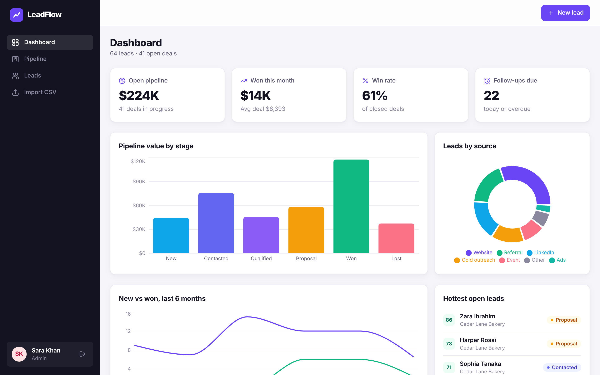
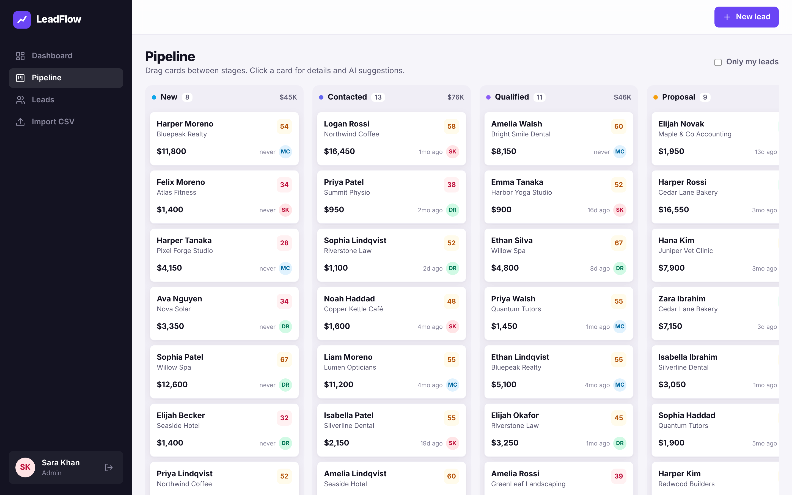
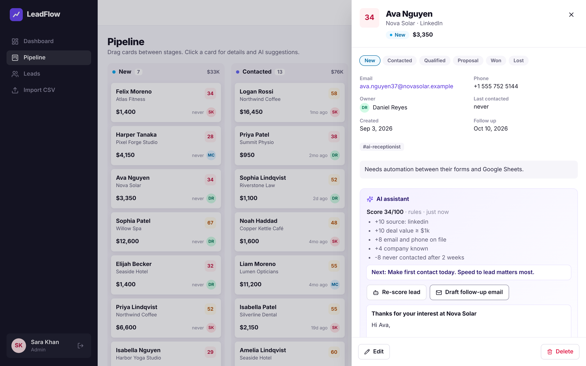
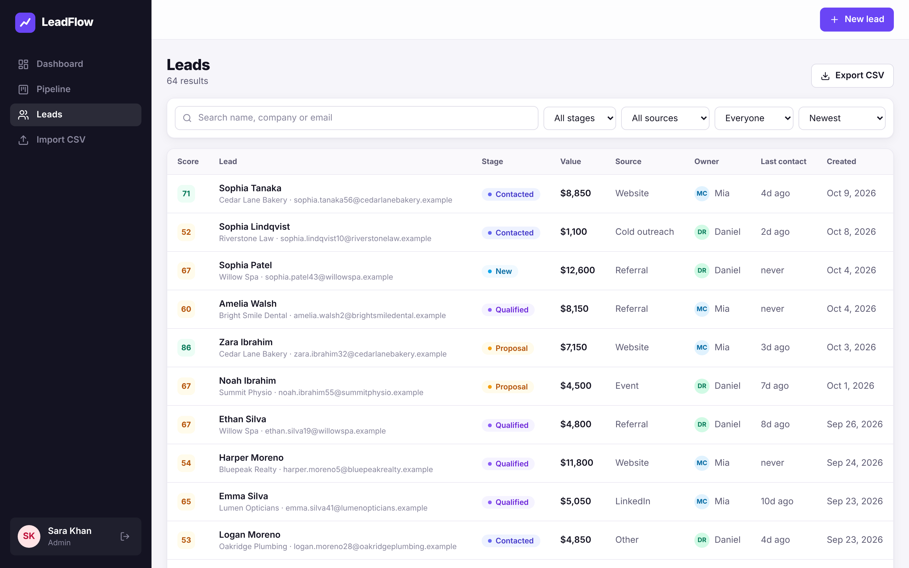

# LeadFlow CRM

**A sales pipeline that tells you which lead to call next, and drafts what to say.**

LeadFlow is a full-stack MERN CRM (MongoDB, Express, React, Node.js). It has:
- a drag-and-drop pipeline;
- AI lead scoring that explains its reasoning;
- one-click follow-up email drafts;
- an activity timeline, CSV import and export, and a live analytics dashboard.



| Pipeline (drag and drop) | Lead detail with AI assistant |
|---|---|
|  |  |



## Features

- **Kanban pipeline:** drag deals between New → Contacted → Qualified → Proposal → Won / Lost.
  - Optimistic UI updates and persistent card order.
  - Every stage change is written to the activity log.
- **AI lead scoring (0–100) with reasons and a suggested next action**
  - **With an `ANTHROPIC_API_KEY`:** Claude scores the lead from its data and recent activity.
  - **Without one:** a transparent rule engine scores it (source quality, deal size, contactability, stage, engagement, recency), for example *"+20 source: referral · −8 never contacted after 2 weeks"*.
  - **If Claude fails:** scoring falls back to the rule engine.
- **AI follow-up emails:** a stage-aware draft (Claude or template) that you can copy straight into your email.
- **Activity timeline:** log notes, calls, emails and meetings.
  - Logging the first conversation automatically moves a new lead to *Contacted* and updates "last contacted".
- **Dashboard**
  - Open pipeline value, won this month, win rate and follow-ups due.
  - Charts: value by stage, leads by source, and new vs won over the last 6 months.
  - The hottest open leads and a rep leaderboard.
- **Leads table:** search, filter by stage, source and owner, sort by score, value or date, and paginate.
- **CSV import**
  - Matches column headers automatically (e.g. "Full Name", "Deal Value", "Lead Source").
  - Validates each row, normalises values like `$4,500`, and skips duplicate emails with a per-row report.
- **CSV export** of the whole pipeline.
- **Auth and roles**
  - JWT in an httpOnly cookie (or a Bearer token for API clients), bcrypt-hashed passwords, rate-limited auth endpoints.
  - The first account becomes **admin**. **Reps** can edit only their own or unassigned leads, and the server enforces this.
- **Security:** helmet with a strict CSP, zod validation on every input, regex-escaped search, consistent error responses.

## Tech stack

| Layer | Tools |
|---|---|
| Front end | React 18, Vite, Tailwind CSS, React Router, TanStack Query, dnd-kit, Recharts, lucide-react |
| Back end | Node.js, Express, Mongoose, zod, JWT, bcrypt, helmet, express-rate-limit, multer + csv-parse |
| Database | MongoDB |
| AI | Anthropic Claude (optional) with a rule-based fallback |
| Quality | Vitest + supertest (18 API tests against a real database), GitHub Actions with a MongoDB service, Docker and docker-compose |

## Quick start

**Docker (MongoDB + app, one command):**
```bash
git clone https://github.com/ahmad0187/leadflow-crm-MERN.git
cd leadflow-crm-MERN
docker compose up --build -d
docker compose exec app node server/src/seed.js     # optional demo data
```
Open http://localhost:4000 and sign in with **admin@leadflow.dev / demo1234**, or click **Use the demo account**.

**Local development** (needs Node 20+ and MongoDB running locally):
```bash
npm run install:all
cp .env.example server/.env
npm run seed          # demo data: 3 users, 64 leads
npm run dev:server    # API on :4000
npm run dev:client    # React on :5173 (proxies /api to :4000)
```

**Tests:**
```bash
npm test              # needs MongoDB; set MONGO_URL to point elsewhere
```

## API overview

All endpoints are under `/api`. Everything except auth and health requires a signed-in user.

| Method | Endpoint | Description |
|---|---|---|
| `POST` | `/auth/register` · `/auth/login` · `/auth/logout` | Sessions (httpOnly cookie; login also returns a token) |
| `GET` | `/auth/me` | Current user |
| `GET` | `/leads?q=&stage=&status=open\|closed&source=&owner=me\|unassigned\|<id>&sort=-score&page=&limit=` | Search, filter and paginate |
| `GET` | `/leads/pipeline` | Leads grouped by stage, in board order |
| `POST` | `/leads` | Create a lead |
| `GET` · `PATCH` · `DELETE` | `/leads/:id` | Read (with timeline), update, delete |
| `PATCH` | `/leads/:id/move` | `{ stage, position }`: move a card and reorder the column |
| `POST` | `/leads/:id/activities` | Log a note, call, email or meeting |
| `POST` | `/leads/:id/score` | AI score with reasons and next action |
| `POST` | `/leads/:id/draft-email` | AI follow-up email draft |
| `POST` | `/leads/import` | CSV upload (multipart `file`) |
| `GET` | `/leads/export.csv` | CSV export |
| `GET` | `/stats` | Dashboard numbers |
| `GET` | `/users` | Team members (for owner assignment) |

## Project structure

```
server/
  src/
    app.js            Express app (security middleware, routes, serves the built client)
    models/           User, Lead, Activity (Mongoose)
    routes/           auth, leads (CRUD, pipeline moves, timeline, AI, CSV)
    services/ai.js    Claude scoring/emails + rule-based fallback
    services/stats.js Dashboard metrics
    middleware/       auth (JWT, roles), validation and error handling
    seed.js           Deterministic demo data
  test/               API tests (auth, leads, permissions, import, stats)
client/
  src/
    pages/            Dashboard, Pipeline, Leads, Import, Login
    components/       Layout, LeadDrawer, LeadForm, UI primitives
    lib/              API client, auth context, formatters
```

## License

MIT. Built by [Ahmad Murtaza](https://github.com/ahmad0187).
